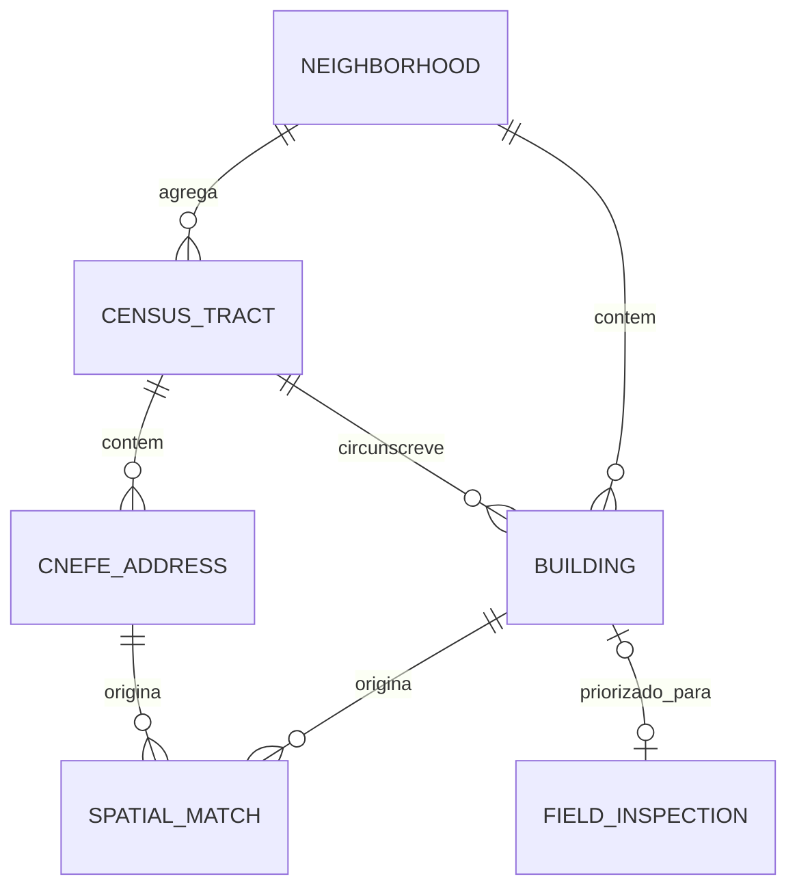

# Atlas Urbano de Paulo Afonso — MVP

Visualizador de **edificações reais** sobre um mapa interativo, aplicado a Paulo Afonso/BA. O sistema cruza duas fontes abertas (polígonos de prédios do Overture Maps e endereços do CNEFE/IBGE), grava o resultado num banco espacial e o expõe por uma API REST em GeoJSON, consumida por um frontend com mapa, legenda por tipo de uso, painel de detalhes e relatório exportável.

> **Retrato estatístico, não cadastro oficial.** Pegada de edificação ≠ área construída, e *footprint* ≠ terreno. Os números refletem as fontes usadas (CNEFE 2022 e Overture) e herdam as limitações delas (ver [Limitações conhecidas](#limitações-conhecidas)).

## Equipe

Projeto da turma de Sistemas de Informação, Paulo Afonso – BA.

| Função | Nome |
| --- | --- |
| Líder da equipe | Caio Lúcio |
| Membro | Arthur Henrique |
| Membro | Elliton Luís |
| Membro | Rafael Santos |
| Membro | Luís Gustavo |
| Membro | João Almeida |

Repositório: <https://github.com/PROJETOWEB2026/EM-PROGRESSO>

## Sumário

1. [Problema e objetivo](#problema-e-objetivo)
2. [Fluxo do sistema](#fluxo-do-sistema)
3. [Dados usados](#dados-usados)
4. [Como rodar](#como-rodar)
5. [Arquitetura](#arquitetura)
6. [API](#api)
7. [Modelo de dados](#modelo-de-dados)
8. [Requisitos e estado de implementação](#requisitos-e-estado-de-implementação)
9. [Casos de uso](#casos-de-uso)
10. [Decisões de engenharia](#decisões-de-engenharia)
11. [Limitações conhecidas](#limitações-conhecidas)
12. [Roadmap](#roadmap)
13. [Estrutura do repositório](#estrutura-do-repositório)

---

## Problema e objetivo

Nenhuma fonte aberta responde sozinha à pergunta *"o que existe em cada prédio da cidade e onde ele está?"*:

- o **Overture Maps** fornece a **forma** (polígono) de cada edificação, com pouca informação de uso;
- o **CNEFE (IBGE)** fornece **endereço e espécie do estabelecimento** (residencial, comercial, religioso etc.), mas apenas como pontos.

O projeto integra as duas: cada ponto de endereço é associado, por relação espacial, à edificação que o contém. O polígono vem do Overture e o tipo de uso vem do IBGE. O resultado serve para consulta por usuários não técnicos e como base para estatísticas por recorte territorial e, futuramente, para priorizar conferência de campo.

## Fluxo do sistema

```
dados reais (Overture + QG/CNEFE)
        ↓
    ETL em Python (import_data.py)
        ↓
    MySQL/MariaDB (tabela espacial `buildings`)
        ↓
    FastAPI (GET /api/buildings, /api/buildings/{id})
        ↓
    React + MapLibre + deck.gl
        ↓
          MAPA
```

## Dados usados

| Fonte | O que fornece | Volume |
| --- | --- | --- |
| `overture-...-building-*.geojson` (janela) + `...-building-municipio.geojson` (município inteiro, mesma release) | Polígono real de cada edificação | 52.809 prédios no município (8.382 na janela original) |
| `qg_810_endereco_*.json` (CNEFE/IBGE, município 2924009) | Endereços e estabelecimentos | 61.965 pontos |
| `osm_buildings_paulo_afonso.geojson` (2ª fonte, via API Overpass/OSM — aberta, sem login) | Polígonos onde o Overture não cobre | 400 prédios (fallback; nenhum endereço novo adotado — o Overture municipal já cobria) |

A tabela `buildings` tem uma linha por endereço QG (61.965) mais os prédios sem nenhum endereço, totalizando **87.951 registros**. 58.178 endereços (93,9%) caíram em polígono; restam 3.787 bolinhas.

**Regras da junção espacial endereço × edificação:**

1. Se o ponto está **dentro** de um polígono, usa esse polígono.
2. Se não, procura polígonos a até **~15 m** (tolerância para porta na fachada ou erro de GPS).
3. Havendo mais de um candidato, escolhe o **mais próximo**.
4. Endereço sem prédio vira um **círculo de ~5 m** ao redor do ponto.

O Overture agora cobre o município inteiro (recortado no contorno oficial): 93,9% dos endereços têm polígono; restam 3.787 bolinhas.

**Tipo de uso**, em ordem de prioridade:

1. código de espécie do QG: `1`=residencial, `2`=hospedagem, `3`=agropecuário, `4`=institucional, `5`=serviço, `6`=comercial, `8`=religioso; `7` (em construção) vira `desconhecido`;
2. subtipo do Overture (ex.: `residential`, `commercial`, `religious`);
3. classe do Overture (ex.: `house`, `retail`, `church`);
4. `desconhecido`.

IDs de endereço duplicados no CNEFE recebem sufixo `#n` para manter a chave primária única.

## Como rodar

Pré-requisitos: Python 3, Node.js, e o `mariadb`/`mariadbd` do sistema já instalados (não precisa rodar o MariaDB como serviço, pois o script sobe uma instância local). Os arquivos de dados brutos devem estar em `data/raw/overture/` e `data/raw/qg/`.

```bash
# 1) Ambiente Python (uma vez)
python3 -m venv .venv
./.venv/bin/pip install -r backend/requirements.txt

# 2) Instalar o app (uma vez)
cd frontend && npm install && cd ..

# 3) Tudo de uma vez (usa dados existentes; importe só quando necessário)
bash scripts/run.sh
```

Para atualizar os dados já importados, rode `bash scripts/run.sh --reimport`.

Ou passo a passo:

```bash
bash scripts/db.sh start      # sobe o MariaDB local (:3306, db atlas_urbano)
./.venv/bin/python import_data.py   # importa e relaciona os dados
./.venv/bin/uvicorn backend.main:app --host 127.0.0.1 --port 8000 &
cd frontend && npm run dev -- --port 5173 &
```

Abra **http://127.0.0.1:5173/**.

Para parar o banco: `bash scripts/db.sh stop`.

**Portas e serviços**

| Serviço | Endereço |
| --- | --- |
| MariaDB local | `127.0.0.1:3306` (banco `atlas_urbano`) |
| Backend FastAPI | `http://127.0.0.1:8000` (docs interativas em `/docs`) |
| Frontend Vite | `http://127.0.0.1:5173` |

**Logs:** `/tmp/atlas-uvicorn.log` (backend), `/tmp/atlas-vite.log` (frontend) e `.mysql-data/mysql.err` (banco).

**Configuração:** as credenciais do banco ficam em `backend/config.py` e, por ora, também no topo de `import_data.py` (ver [Limitações conhecidas](#limitações-conhecidas)). O CORS do backend aceita apenas `localhost:5173` e `127.0.0.1:5173`.

## Arquitetura

Arquitetura em **camadas**, com um módulo de carga em lote separado da aplicação web:

| Camada | Responsabilidade | Tecnologia |
| --- | --- | --- |
| Carga (ETL) | Ler, cruzar, normalizar e gravar os dados | Python, Shapely (STRtree), PyMySQL |
| Persistência | Armazenar geometrias com índice espacial | MariaDB/MySQL (`GEOMETRY` + `SPATIAL INDEX`) |
| Backend | Expor os dados como GeoJSON via HTTP | FastAPI, Uvicorn, PyMySQL |
| Frontend | Renderizar, filtrar e gerar relatório | React, Vite, TypeScript, MapLibre GL, deck.gl |
| Orquestração | Subir o ambiente local | Scripts Bash (`run.sh`, `db.sh`) |

**Componentes**

- **Carga (`import_data.py`)**: `load_buildings`, `load_qg_points`, `relate_points_to_buildings` (junção espacial), `best_type` (cascata de classificação) e `main` (recria a tabela e insere em lotes de 500).
- **Backend**: `main.py` (rotas), `db.py` (conexão, consulta e conversão linha → Feature) e `config.py` (credenciais).
- **Frontend**:
  - `App.tsx`: mapa, camadas deck.gl, seleção, legenda e painel de detalhes;
  - `Report.tsx`: filtros, totais por tipo e por bairro, exportação para PDF;
  - `constants.ts`: ordem e cores dos tipos de uso, fonte única para mapa, legenda e relatório;
  - `BuildingProps`: interface tipada das propriedades de cada edificação.

**Divisão de papéis no frontend**

| Biblioteca | Papel |
| --- | --- |
| React | Estado e interface (painéis, legenda, relatório) |
| MapLibre GL | Mapa base (OpenStreetMap), câmera e navegação |
| deck.gl | Renderização em massa via WebGL: polígonos, seleção por clique, extrusão 3D |

## API

| Método e rota | Descrição | Respostas |
| --- | --- | --- |
| `GET /` | Verificação de saúde (`{"status": "ok", "service": "atlas-urbano-api"}`) | 200 |
| `GET /api/buildings` | Edificações como `FeatureCollection` GeoJSON. Filtros opcionais: `?bbox=minLng,minLat,maxLng,maxLat` (usa o índice espacial), `?bairro=` (repete para vários), `?tipo=`, `?fonte=`. `?light=true` devolve só os campos de renderização. Paginação com `?limit=` (máx. 20000) e `?after_id=` (cursor por ID) ou `?offset=`. Sem parâmetros, devolve tudo de uma vez (comportamento antigo) | 200, 422 (bbox/limite inválido) |
| `GET /api/buildings/{building_id}` | Uma edificação como `Feature` GeoJSON | 200, 404 |
| `GET /api/stats` | Agregados (`total`, `by_tipo`, `by_bairro`, `area_total_m2`, `area_media_m2`) com os mesmos filtros de `bbox`/`bairro`/`tipo`/`fonte` | 200, 422 |

**Propriedades de cada Feature**

| Campo | Tipo | Descrição |
| --- | --- | --- |
| `id` | string | Código único do endereço (com sufixo `#n` se duplicado) ou ID do prédio Overture |
| `area_m2` | number | Área aproximada em m², projetada localmente em torno do próprio prédio |
| `tipo` | string | `residencial`, `comercial`, `servico`, `religioso`, `institucional`, `hospedagem`, `agropecuario` ou `desconhecido` |
| `endereco` | string \| null | Logradouro e número (CNEFE) |
| `bairro` | string \| null | Localidade (CNEFE) |
| `estabelecimento` | string \| null | Descrição do estabelecimento (CNEFE) |
| `num_pavimentos` | number \| null | Pavimentos, quando o Overture informa |
| `fonte` | string \| null | Dataset de origem; `QG/CNEFE` indica endereço sem polígono de prédio |

## Modelo de dados

### Modelo atual (MVP)

Uma única tabela espacial, recriada a cada carga:

```
buildings(id, geom, area_m2, tipo, endereco, bairro,
          estabelecimento, num_pavimentos, fonte)
```

Todas as geometrias estão em **SRID 0** (coordenadas lon/lat sem sistema de referência declarado), o que limita o uso de funções geográficas nativas do banco.

### Modelo-alvo (documentação)

A documentação define um modelo normalizado, a ser adotado nas próximas etapas:

| Entidade | Papel | Campos principais |
| --- | --- | --- |
| `NEIGHBORHOOD` | Bairro e estatísticas agregadas | nome, código IBGE do município, área total e mediana, nº de edificações e de endereços, densidade (edif./km²) |
| `CENSUS_TRACT` | Setor censitário | código do setor, município, tipo, geometria `MultiPolygon` (SRID 4674) |
| `BUILDING` | Telhado/edificação | `roof_geom` (4674), `utm_geom_24s` (31984), área, fonte primária, `source_confidence`, `source_agreement`, `verification_level` |
| `CNEFE_ADDRESS` | Endereço do CNEFE | código CNEFE, latitude/longitude, geometria `Point` (4674), logradouro, número, complemento, CEP, espécie |
| `SPATIAL_MATCH` | Associação N:M entre telhado e endereço | distância em metros, `is_exact_match`, `is_within_5m`, `is_within_10m`, `processed_at` |
| `FIELD_INSPECTION` | Conferência de campo | pontuação de prioridade, pavimentos observados, status, foto de referência, data |



**Regras do modelo-alvo**

- **Um telhado para N endereços** (prédio vertical, lote com múltiplos endereços), resolvido pela tabela associativa `SPATIAL_MATCH`. Isso corrige a ambiguidade do MVP, em que o mesmo polígono se repete.
- **Armazenar em 4674 (SIRGAS 2000), medir em 31984 (SIRGAS 2000 / UTM 24S)**: geometria canônica em graus, geometria projetada para cálculos de área e distância.
- `verification_level`: `automatico` → `conferido_tela` → `conferido_campo`.
- `source_agreement`: `concordam` / `divergem` / `so_uma_fonte`.

## Requisitos e estado de implementação

A coluna **Estado** é uma avaliação do código atual (MVP) contra a documentação inicial.

### Requisitos funcionais

| ID | Requisito | Estado | Observação |
| --- | --- | --- | --- |
| RF01 | Baixar endereços (CNEFE) por município a partir do IBGE | Parcial | O arquivo é fornecido manualmente em `data/raw/qg/`; não há download automatizado |
| RF02 | Baixar malhas territoriais oficiais (setores e bairros) | Planejado | O bairro hoje vem do campo de localidade do CNEFE |
| RF03 | Edificações de duas fontes independentes (Overture e Google Open Buildings) | Parcial | Apenas Overture |
| RF04 | Classificar cada endereço por espécie | Implementado | Mapeamento `ESPECIE_TO_TIPO` |
| RF05 | Associar cada endereço à edificação mais próxima, com raio documentado | Implementado | Contém → tolerância de ~15 m → mais próximo |
| RF06 | Campos de confiança (`confianca_fonte`, `concordancia_fontes`, `nivel_verificacao`, `prioridade_campo`) | Planejado | Depende de uma segunda fonte (RF03) |
| RF07 | Gerar e priorizar a fila de conferência de campo (`fila_conferencia.csv`) | Planejado | |
| RF08 | Tabela mestra de estatísticas por recorte territorial | Parcial | O relatório traz contagem por tipo e por bairro; faltam área somada e mediana, densidade, endereços por edificação e % em construção |
| RF09 | Mapa interativo offline, com simbologia por densidade, faixa de área e endereços clusterizados | Parcial | Mapa interativo com cor por tipo de uso; usa tiles online e não tem clusterização nem simbologia por densidade ou área |
| RF10 | Usuário externo (não técnico) consulta o mapa e as estatísticas publicados | Parcial | Funciona localmente; ainda não há publicação |

### Requisitos não funcionais

| ID | Requisito | Categoria | Estado | Observação |
| --- | --- | --- | --- | --- |
| RNF01 | Custo total R$ 0,00 | Econômico | Atendido | Apenas dados e ferramentas abertos; tiles públicos do OSM e OpenFreeMap |
| RNF02 | Reprodutibilidade a partir do pacote e das receitas | Manutenibilidade | Parcial | Há scripts e `requirements.txt`, mas as versões das dependências não estão fixadas e os dados brutos são manuais |
| RNF03 | Cobertura de 100% do perímetro urbano processado | Completude | Parcial | Overture municipal (52.809 prédios) + fallback OSM (400); faltam os ~3,8 mil endereços ainda sem polígono |
| RNF04 | Taxa de associação endereço–edificação ≥ 85% (piloto: 93%) | Qualidade de dados | Atendido | 93,9% dos endereços caem em polígono (58.178 de 61.965) |
| RNF05 | Nenhum dado pessoal armazenado ou publicado | Privacidade | A verificar | Guarda-se endereço e estabelecimento; conferir se `estabelecimento` não expõe dados pessoais |
| RNF06 | Apenas fontes com licença compatível (vedados Google Maps/Street View, DNE dos Correios, Mapillary) | Legal | Atendido | Fontes em uso: OpenStreetMap, Overture e IBGE |
| RNF07 | Toda estatística publicada carrega fonte, método e limitação | Confiabilidade | Parcial | O painel de detalhes mostra a fonte por edificação; o relatório ainda não exibe método e limitação |

## Casos de uso

Atores: **Cliente** (consulta mapa e relatórios) e **Equipe Mantenedora** (carga, processamento e fila de conferência).

| Caso de uso | Ator | Estado |
| --- | --- | --- |
| Visualizar edificações no mapa | Cliente | Implementado |
| Filtrar por tipo de uso | Cliente | Implementado (no relatório) |
| Filtrar por bairro | Cliente | Implementado (no relatório) |
| Consultar dados agregados por bairro/setor | Cliente | Parcial (bairro sim; setor não) |
| Emitir relatório estatístico | Cliente | Implementado (exporta PDF pelo navegador) |
| Carregar a base de edificações e endereços | Equipe Mantenedora | Implementado (`import_data.py`) |
| Cruzar endereços × telhados | Equipe Mantenedora | Implementado (`relate_points_to_buildings`) |
| Gerar fila de conferência de campo | Equipe Mantenedora | Planejado |

## Decisões de engenharia

| Decisão | Por quê | Custo |
| --- | --- | --- |
| **ETL separado da API** | O cruzamento espacial é pesado e raro; a API é leve e constante. Separar evita pagar o custo do cruzamento a cada requisição. | Dados só mudam ao reexecutar a carga |
| **Índice espacial (STRtree) no ETL** | Evita comparação força-bruta O(n×m) entre ~62 mil pontos e ~8 mil polígonos. | Índice em memória |
| **Vocabulário próprio de tipos de uso** | Isola o sistema dos códigos do IBGE e das classes do Overture (camada anticorrupção); se uma fonte mudar, só o ETL muda. | Mapeamentos a manter |
| **Cascata de fallback do tipo** | Sempre existe um valor válido, e a fonte mais confiável prevalece. | Prioridade fixa no código |
| **Carga idempotente (`DROP` + recria)** | Rodar duas vezes dá o mesmo resultado, sem lixo acumulado. | Não é incremental; falha no meio deixa o banco vazio |
| **API como único acesso ao banco** | Credenciais nunca chegam ao navegador; permite trocar o banco sem tocar na interface. | Uma camada a mais |
| **GeoJSON como contrato** | Padrão aberto (RFC 7946), consumível por QGIS, Leaflet, deck.gl etc. | Verboso para grandes volumes |
| **FastAPI** | Leve, tipado, com documentação automática; Django traria ORM e admin sem uso. | |
| **Consultas parametrizadas** | Protege contra injeção de SQL. | |
| **deck.gl sobre MapLibre** | WebGL aguenta dezenas de milhares de polígonos com seleção e extrusão; MapLibre é open source e dispensa chave de API. | Duas bibliotecas de mapa para integrar |
| **Estado local com hooks, dados derivados com `useMemo`** | O estado é pequeno; uma biblioteca global seria complexidade sem retorno. Há uma única fonte de verdade (`data`) e o resto é derivado. | |
| **3D com degradação graciosa** | Se o serviço externo de tiles vetoriais falhar, o mapa base continua. | |
| **Retry no carregamento** | O backend pode estar subindo; são 5 tentativas com 2 s de intervalo. | |
| **PDF via `window.print()` + CSS `@media print`** | Gera o relatório sem biblioteca extra nem backend de relatórios. | Pouco controle de layout |
| **MariaDB local isolado por script** | Reprodutibilidade em ambiente restrito, sem exigir serviço instalado. | Depende de Linux/Bash e do `mariadbd` instalado |

**Recursos 3D:** todo volume 3D é uma feature nossa extrusada pelo deck.gl — portanto tem sempre a cor do tipo e, ao clicar, o endereço. Prédios com `num_pavimentos` usam `pavimentos × 3 m` (dado do Overture); o restante usa altura ilustrativa de 5 m. Não há camada 3D externa (a anterior, do OpenFreeMap/OSM, era cinza e sem vínculo com nossos endereços).

## Limitações conhecidas

- **Carga do mapa por área visível**: inicia no centro em zoom 17,5 e busca lotes leves pela área visível; zoom out ou movimento busca novas áreas. O relatório consulta agregados no servidor.
- **"Edificação" é ambígua**: a tabela tem uma linha por endereço, então 87.951 registros não são 87.951 prédios. O relatório rotula a contagem como "Edificações".
- **Prédios sem endereço nem tipo** (~26 mil): o Overture municipal trouxe a forma, mas sem uso conhecido (ficam `desconhecido` até conferência de campo ou 2ª fonte com atributo).
- **Acoplamento por *magic string***: o frontend identifica "endereço sem prédio" pelo valor `fonte = 'QG/CNEFE'`. Um campo explícito (ex.: `tem_poligono`) seria mais robusto.
- **ETL monolítico e destrutivo**: leitura, cruzamento, transformação e carga num único script, sem transação protegendo o estado anterior.
- **Credenciais fixas e duplicadas** (`atlas`/`atlas`) em `config.py` e `import_data.py`; deveriam vir de variáveis de ambiente, numa configuração única.
- **SRID 0** em todas as geometrias; a área é calculada no ETL por projeção local aproximada.
- **Heurística espacial simples**: em ponto ambíguo, escolhe o polígono mais próximo, sem tratar multiplicidade.
- **Sem testes automatizados**; o cruzamento espacial ainda é validado por inspeção visual e contagens.
- **Dependência de serviços externos de tiles** (OpenStreetMap e OpenFreeMap), o que contraria o objetivo de mapa offline (RF09).
- **Dependências sem versão fixada** em `requirements.txt` (`fastapi`, `uvicorn[standard]`, `pymysql`, `shapely`).

## Roadmap

Em ordem sugerida de prioridade:

1. **Modelo de dados**: migrar para o modelo normalizado (`BUILDING`, `CNEFE_ADDRESS`, `SPATIAL_MATCH`), resolvendo a relação 1 telhado × N endereços; adotar SRID 4674 para armazenar e 31984 para medir.
2. **Qualidade do ETL**: carga em tabela de *staging* com troca atômica, configuração por variáveis de ambiente, versões fixadas das dependências e testes do cruzamento espacial.
3. **Cobertura e qualidade**: ampliar a janela do Overture para o perímetro urbano inteiro (RNF03), medir a taxa de associação (RNF04) e incluir a segunda fonte, Google Open Buildings (RF03).
4. **Confiança e conferência de campo**: calcular `confianca_fonte`, `concordancia_fontes`, `nivel_verificacao` e `prioridade_campo` (RF06) e gerar `fila_conferencia.csv` (RF07).
5. **Estatísticas**: tabela mestra por bairro e setor com área somada e mediana, densidade e % em construção (RF08), cada uma com fonte, método e limitação (RNF07). Para isso, baixar as malhas oficiais de setores e bairros (RF02).
6. **Escala da API**: filtros (`?bairro=`, `?bbox=`), paginação ou *vector tiles*, e eventual migração para PostGIS.
7. **Mapa**: simbologia por densidade e faixa de área, clusterização de endereços e opção offline (RF09).
8. **Publicação**: disponibilizar mapa e estatísticas para usuários externos (RF10), com Docker Compose para simplificar a instalação.

## Estrutura do repositório

```
backend/            API FastAPI (o frontend nunca acessa o MySQL diretamente)
  config.py         conexão/credenciais do banco
  db.py             consultas → GeoJSON
  main.py           rotas /, /api/buildings e /api/buildings/{id}
  requirements.txt  dependências Python do backend
frontend/           React + Vite + TS + MapLibre + deck.gl
  src/App.tsx       mapa, camadas, painel, legenda, relatório
  src/Report.tsx    relatório (totais, filtros, exportar PDF)
  src/constants.ts  cores e ordem dos tipos de uso
  src/index.css     estilos (inclui regras de impressão do relatório)
  src/main.tsx      ponto de entrada React
scripts/
  db.sh             sobe/para o MariaDB local
  run.sh            sobe tudo (banco, importação, backend, frontend)
  mysql-local.cnf   tmpdir do MariaDB (sem /var/tmp no ambiente)
import_data.py      Overture + QG → relação espacial → tabela `buildings`
data/raw/           arquivos fornecidos (overture/ e qg/)
```

## Pontos de extensão

A carga (`import_data.py`) e o endpoint `GET /api/buildings` são os lugares onde entram novas fontes (importação IBGE/prefeitura), filtros (`?bairro=X`) e paginação.
